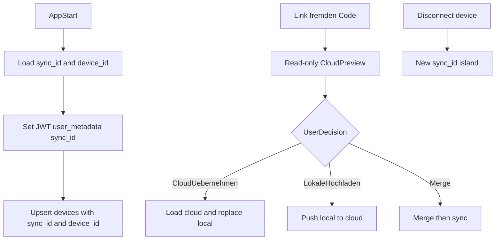

# Phase 15: Safe-Sync, Device Dashboard, Disconnect

## Zielbild

- `sync_id` bleibt Familien-/Mandanten-ID.
- `device_id` wird pro Gerät stabil lokal gespeichert.
- Fremden Code koppeln nur über Safe-Sync-Entscheidung (kein blindes `setSyncId`).
- Geräteübersicht zeigt aktive Geräte + last_active + Datenzähler.
- „Gerät trennen“ erzeugt isolierte neue Familie und leert States/Caches sauber.

## 1) Schema-Verfeinerung für `devices`

**Dateien**

- `[C:\Users\Alex777\.cursor\worktrees\fami-do-task_2026\zjm\scripts\supabase-create-all-tables.sql](C:\Users\Alex777\.cursor\worktrees\fami-do-task_2026\zjm\scripts\supabase-create-all-tables.sql)`
- (neu) `[C:\Users\Alex777\.cursor\worktrees\fami-do-task_2026\zjm\scripts\supabase-devices-phase15.sql](C:\Users\Alex777\.cursor\worktrees\fami-do-task_2026\zjm\scripts\supabase-devices-phase15.sql)`

**Änderung**

- `devices` von `sync_id PRIMARY KEY` auf gerätefähiges Modell umstellen:
  - `id UUID PRIMARY KEY` (entspricht `device_id`)
  - `sync_id TEXT NOT NULL`
  - `device_name TEXT`
  - `last_active TIMESTAMPTZ NOT NULL DEFAULT now()`
- Indexe:
  - `idx_devices_sync_id` auf `sync_id`
  - optional `idx_devices_last_active` auf `last_active desc`
- RLS bleibt sync_id-basiert (JWT `user_metadata.sync_id`), damit bestehende Datendomäne nicht bricht.

**Wichtig**

- Für bestehende Umgebungen Migration-Skript statt Hard-Reset (Drop/Alter), damit keine Daten verloren gehen.

## 2) Stabile lokale `device_id` + Heartbeat korrigieren

**Dateien**

- `[C:\Users\Alex777\.cursor\worktrees\fami-do-task_2026\zjm\hooks\useSyncSession.ts](C:\Users\Alex777\.cursor\worktrees\fami-do-task_2026\zjm\hooks\useSyncSession.ts)`
- `[C:\Users\Alex777\.cursor\worktrees\fami-do-task_2026\zjm\hooks\useSyncId.ts](C:\Users\Alex777\.cursor\worktrees\fami-do-task_2026\zjm\hooks\useSyncId.ts)`

**Änderung**

- Konstante `DEVICE_ID_KEY` ergänzen (z. B. `famiapp-device-id`).
- Beim App-Start:
  - lokale `device_id` laden, sonst `crypto.randomUUID()` erzeugen und persistieren.
- Heartbeat-Upsert in `devices` auf `id=device_id` umstellen (`onConflict: "id"`).
- Payload: `id`, `sync_id`, `device_name`, `last_active`, Gerätedetails.

## 3) Safe-Sync-Modal vor Aktivierung fremder `sync_id`

**Dateien**

- `[C:\Users\Alex777\.cursor\worktrees\fami-do-task_2026\zjm\components\cloud-sync\CloudSyncPanel.tsx](C:\Users\Alex777\.cursor\worktrees\fami-do-task_2026\zjm\components\cloud-sync\CloudSyncPanel.tsx)`
- `[C:\Users\Alex777\.cursor\worktrees\fami-do-task_2026\zjm\components\settings\settings-backup.tsx](C:\Users\Alex777\.cursor\worktrees\fami-do-task_2026\zjm\components\settings\settings-backup.tsx)`
- `[C:\Users\Alex777\.cursor\worktrees\fami-do-task_2026\zjm\lib\supabase-sync.ts](C:\Users\Alex777\.cursor\worktrees\fami-do-task_2026\zjm\lib\supabase-sync.ts)`

**Änderung**

- In `handleLink` kein direktes `setSyncId(code)` mehr.
- Erst Read-only Cloud-Preview laden (Counts für children/tasks/rewards/rules/... + optional last_updated).
- Modal im Stil des lokalen Import-Modals anzeigen:
  - „Cloud-Daten übernehmen“
  - „Lokale Daten hochladen“
  - „Zusammenführen“
- Erst nach Auswahl Code aktivieren und gewählten Flow ausführen.

**Flow-Guard**

- Leeres lokales Gerät darf ohne explizite Wahl nie automatisch Cloud überschreiben.
- Fehlerzustände (RLS, fehlende Tabellen) mit klaren Handlungshinweisen abfangen.

## 4) Device Dashboard in CloudSyncPanel integrieren

**Dateien**

- `[C:\Users\Alex777\.cursor\worktrees\fami-do-task_2026\zjm\components\cloud-sync\CloudSyncPanel.tsx](C:\Users\Alex777\.cursor\worktrees\fami-do-task_2026\zjm\components\cloud-sync\CloudSyncPanel.tsx)`
- `[C:\Users\Alex777\.cursor\worktrees\fami-do-task_2026\zjm\components\sync\DeviceDashboard.tsx](C:\Users\Alex777\.cursor\worktrees\fami-do-task_2026\zjm\components\sync\DeviceDashboard.tsx)`

**Änderung**

- Dashboard unter dem Familien-Code anzeigen.
- Live-Query auf `devices` der aktuellen `sync_id`.
- Darstellung je Gerät:
  - Icon (Handy/Tablet)
  - `device_name`
  - „Zuletzt aktiv“ (relative Zeit)
- Zusatzstatistik:
  - „Synchronisierte Daten: X Aufgaben, Y Belohnungen“ (leichte Count-Queries, kein Traffic-Metering).

## 5) Bug-freier Disconnect-Flow

**Dateien**

- `[C:\Users\Alex777\.cursor\worktrees\fami-do-task_2026\zjm\components\sync\DeviceDashboard.tsx](C:\Users\Alex777\.cursor\worktrees\fami-do-task_2026\zjm\components\sync\DeviceDashboard.tsx)`
- `[C:\Users\Alex777\.cursor\worktrees\fami-do-task_2026\zjm\context\...` (State-Store/Provider)](C:\Users\Alex777.cursor\worktrees\fami-do-task_2026\zjm\context)
- `[C:\Users\Alex777\.cursor\worktrees\fami-do-task_2026\zjm\hooks\...` (sync/cache hooks)](C:\Users\Alex777.cursor\worktrees\fami-do-task_2026\zjm\hooks)

**Änderung**

- Dialog „Gerät trennen“ mit Optionen:
  - **Daten behalten**: neue `sync_id` erzeugen, lokale Datensätze auf neue `sync_id` umstellen, als neue Insel pushen.
  - **Neustart**: neue `sync_id`, lokale App-Daten leeren.
- Danach konsistent:
  - Realtime-Channels neu subscriben
  - React-State resetten
  - Query-/Local-Caches invalidieren
  - UI sofort auf neue Familie umschalten (keine Geisterdaten)

## 6) Qualitäts- und Sicherheitschecks

**Checks**

- Build ohne Parse-/Type-Fehler.
- Koppeln fremder `sync_id`: ohne Entscheidung kein Write.
- Mehrere Geräte in einer Familie sichtbar (nicht überschrieben).
- Disconnect erzeugt garantiert unbenutzte neue `sync_id` und saubere UI.

**Testfälle (manuell)**

- Zwei Browserprofile als „Mama/Papa“:
  - gemeinsamer Code → beide Geräte in Liste, `last_active` aktualisiert.
  - leeres Gerät + fremder Code → Safe-Sync-Modal erscheint.
  - beide Disconnect-Optionen je einmal durchspielen.

## Reihenfolge der Umsetzung

1. DB-Schema/Migration `devices`
2. `useSyncSession` auf `device_id`
3. Safe-Sync-Modal + Preview-Gate
4. Device Dashboard im Panel
5. Disconnect-Härtung + Cache-Reset
6. End-to-End Tests

